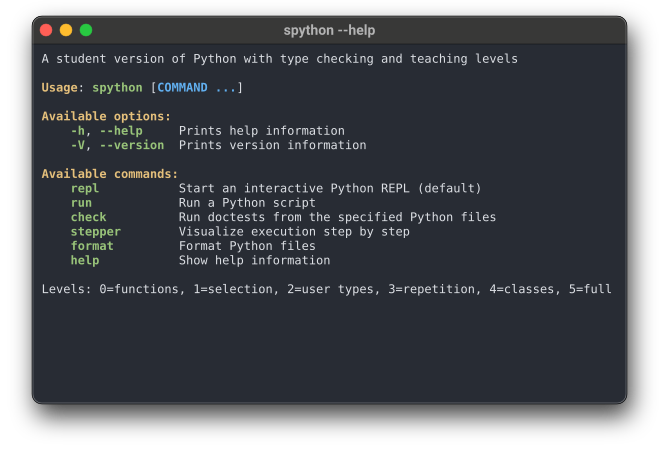

# spython

spython is a version of [Python](https://www.python.org/) for students. It
checks types before running anything, so every function has to be annotated,
and restricts the language by level. It has a REPL and comes with libraries
for drawing images and writing interactive programs, in the spirit of
[HtDP](https://htdp.org/).

You can try it in the browser at <https://malbarbo.pro.br/spython/>. The web
version has an editor, the REPL, and shows images and interactive programs
inline.

spython runs the code on [RustPython](https://github.com/RustPython/RustPython)
and checks it with [ty](https://github.com/astral-sh/ty), the type checker
from the ruff project. There is a similar project for Gleam,
[sgleam](https://github.com/malbarbo/sgleam).

<p align="center">
  <picture>
    <source media="(prefers-color-scheme: dark)" srcset="docs/spython-dark.svg" />
    <source media="(prefers-color-scheme: light)" srcset="docs/spython-light.svg" />
    
  </picture>
</p>

## Install

Download the archive for your system from the
[releases page](https://github.com/malbarbo/spython/releases), extract it, and
put the `spython` binary somewhere on your `PATH`. That is all. The
interpreter, the type checker, and the library ship inside the binary.

To build from source you need stable Rust:

```sh
cargo build --release
```

## Use

`spython` with no arguments starts the REPL. It highlights the code as you
type, completes names with tab, and checks the types of each input before
running it.

To run a program, give it the file:

```sh
spython run hello.py
```

spython checks the file first. A function without annotations, or a
construct the current level does not allow, is an error, and the program does
not run.

Tests are doctests. They state what a function returns for a few inputs, and
`spython test` runs them after checking their types too:

```python
def double(x: int) -> int:
    """
    >>> double(0)
    0
    >>> double(3)
    6
    """
    return x * 2
```

`spython format` formats a file, `spython format --check` says which files
are not formatted without changing them, and `spython repl file.py` loads the
definitions of a file into the REPL. `spython --help` lists the rest.

### Levels

A course introduces Python a piece at a time, and spython follows along. The
`--level` option says how much of the language a program can use. The default
is 0.

| Level | Name       | Adds                                                              |
| ----- | ---------- | ----------------------------------------------------------------- |
| 0     | Functions  | `def`, `return`, scalars, string indexing                         |
| 1     | Selection  | `if`/`elif`/`else`                                                |
| 2     | User types | `class` (Enum / `@dataclass`), `match`                            |
| 3     | Repetition | `list` literals, `for`, `while`, `+=`                             |
| 4     | Classes    | full `class` with methods, `dict`/`set`, comprehensions, `lambda` |
| 5     | Full       | unrestricted (only annotations still required)                    |

Up to level 3, spython also refuses a few things that are legal Python but
usually a mistake for a beginner. A condition has to be a `bool`, a `bool`
cannot take part in arithmetic, comparisons cannot be chained, an expression
whose value is thrown away is an error, and a parameter cannot have a default
value. Level 4 lifts all of these.

### Standard library

Only `dataclasses`, `enum`, `typing`, and `math` are available, together with
the `spython` package for images and interactive programs. Importing anything
else, such as `random`, `re`, or `os`, is an error. The point is that a
student writes the algorithm instead of finding it in a library.

## Images and interactive programs

The `spython` package builds a picture out of shapes, places pictures over,
beside, and above each other, and rotates, scales, and crops them. A picture
is an SVG.

```python
from spython import blue, circle, fill, overlay, rectangle, red, stroke

image = overlay(circle(30, stroke(red)), rectangle(80, 50, fill(blue)))
```

The `World` class is for animations and games. A program is a state, a
function that draws the state, and functions that update the state on each
tick of the clock or key press:

```python
World(initial_state, draw).on_tick(tick).on_key_press(key).run()
```

Both work best in the web version, which shows the picture as you go. The
[examples](examples/) directory has a complete program.

## Documentation

The guides are in [English](docs/en/) and in
[Portuguese](docs/pt-br/). There is one for the command line and one for the
web version.

## Development

The workspace has three crates. `engine` has the checker, the completion,
and the FFI. `cli` is the binary, and `wasm` is the build for the browser.

```sh
make check               # clippy, cargo fmt, ruff format, deno fmt
cargo test --workspace   # the tests
make test                # the tests, plus the WASM and image tests
make wasm                # the WASM binary
```

## License

MIT. See [LICENSE](LICENSE).
